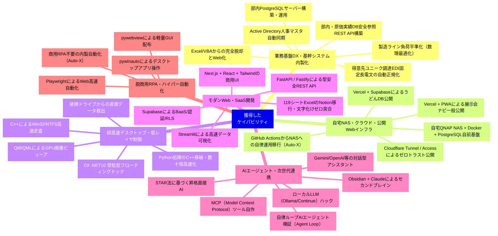

# 🚀 半年間のスキル習得＆「できるようになったこと」ケイパビリティマップ

> **対象期間**: 2026年3月〜11月（本格開始の5月以降を中心とする約8ヶ月間）  
> **開発規模**: 全48+プロジェクト / 総コミット数 1,400+ / 6言語以上 / 自宅NAS・インフラ〜低レイヤ〜クラウド公開まで全方位網羅

---

## 1. 全体像：半年で獲得した「6大ケイパビリティ領域」

この期間で、単にプログラミング言語の文法を覚えただけでなく、**「現実の複雑な業務課題・性能問題・インフラ運用・一般公開Webまで、最適な技術を選択してゼロから完結できるフルサイクル能力」** を手に入れました。



---

## 2. 6大領域別：スキル ×「できるようになったこと」詳細マップ

### ① 業務基盤DX・基幹システム内製化 (Enterprise DX & Data Engineering)
> **「属人化したExcel・ブラックボックス業務を、セキュアで堅牢な内製Webシステムへ刷新できる」**

| できるようになったこと（能力・解決課題） | 活用・習得したスキル | 代表プロジェクト |
| :--- | :--- | :--- |
| **Excel/VBA見積業務の脱却とWeb化**<br>膨大なマクロに依存した原価見積を、ブラウザ上で誰でも入力・承認できるデータベース連動システムへ移行 | Python, FastAPI, PostgreSQL, HTML5/CSS, SQLチューニング | [shisaku-system](#shisaku-system) |
| **得意先ユニーク調達EDI固定長電文の自動解析**<br>Shift_JIS固定長テキスト電文を自動パースし、リレーショナルDBへ正規化格納するミッションクリティカル処理（88+コミット） | Python (バイナリ/文字コード処理), PostgreSQL, 正規表現, トランザクション管理 | [chumonsho-2seikan](#chumonsho-2seikan) |
| **購入部品原価実績DBの安全参照REST API構築**<br>基幹サーバー上の機密実績データを、最小権限・接続数制御・ローカル限定で安全にAPI提供（Fastify/TypeScript） | Node.js, Fastify, TypeScript, PostgreSQL, REST API設計 | [buhin-jisseki](#buhin-jisseki) |
| **Active Directory（AD）連携による人事マスタ自動同期**<br>組織・社員・役職データをADから自動取得し、常に最新の権限・人事DBを社内に提供 | Python (LDAP/AD連携), PostgreSQL, React, Vite, FastAPI | [jinji-db](#jinji-db) |
| **数理最適化アルゴリズムによる設備負荷平準化**<br>多階層BOM（部品構成）と設備の制約条件から、混合整数線形計画法（MILP）で最適な生産計画を自動算出 | Python (PuLP/SciPy), Pandas, FastAPI, Rust (高速化エンジン) | [myerp](#myerp) |
| **部内専用PostgreSQLサーバーの構築・自動運用**<br>PowerShellで自動セットアップし、ロール・権限管理、Power Automate連携、IT部門向け手順書まで整備 | PowerShell, PostgreSQL運用管理, セキュリティ設計, バッチ自動化 | [bunai-server](#bunai-server) |

---

### ② 自宅NAS・クラウドインフラ＆公開Web運用 (Self-Hosted Cloud, Infra & Public Web)
> **「社内オンプレ、自宅プライベートNAS（Docker/PostgreSQL/Cloudflare）、パブリッククラウド（Vercel/Supabase）まで、24時間稼働インフラと一般公開Webサービスを一人で設計・運用できる」**

| できるようになったこと（能力・解決課題） | 活用・習得したスキル | 代表プロジェクト |
| :--- | :--- | :--- |
| **自宅QNAP NAS上でのDocker+PostgreSQL常時稼働基盤**<br>初期はGitHub Actionsで自動実行していた処理を、データ主権と自律運用のため自宅NASへ完全移行。PostgreSQL 16、自動同期Worker、Web UIをコンテナ化して24時間安定稼働 | Docker, Docker Compose, PostgreSQL 16, QNAP NAS (Container Station), GitHub Actions (初期検証) | [Auto-X](#Auto-X) |
| **Cloudflare Tunnel / Accessによるゼロトラスト外部公開**<br>自宅ルーターのポート開放を一切行わず、Cloudflare Named Tunnelで安全にHTTPS公開。Cloudflare Accessの個人認証ゲートウェイと14世代自動バックアップを完備したプライベートSaaS基盤 | Cloudflare Tunnel, Cloudflare Access, Docker Compose, Next.js (standalone), pg_dump自動化 | [camp](#camp), [Auto-X](#Auto-X) |
| **展示会ナビゲーションPWAの一般公開（業務外Web開発）**<br>東京ビッグサイトのFieldStyle Japan 2026向けに、フロア跨ぎ最短ルート案内・オフライン動作を備えたPWAをVercelに公開運用（一般利用可能） | Vite, React, TypeScript, PWA (Service Worker), Vercel デプロイ, UI/UX設計 | [FieldStyle2026](#FieldStyle2026)（[公開サイト](https://fieldstyle-nav.vercel.app)） |
| **Supabase + Vercelによるクラウド店舗DB公開運用**<br>香川うどんツアー記録を7テーブル（店舗・営業時間・訪問履歴・写真等）に正規化し、Google Maps座標連携とVercel Serverlessで一般公開 | Supabase (PostgreSQL 東京), Vercel, JavaScript, Google Maps API | [udon-db](#udon-db) |
| **Cloudflare Workers / PagesによるNext.jsエッジ配信**<br>Wranglerを用いたエッジサーバーレス環境へのWebアプリケーション配備・運用 | Cloudflare Workers, Cloudflare Pages, Next.js, Wrangler | [jugo-shoten-web](file:///c:/Users/developer/jugo-shoten-web) |

---

### ③ 超高速デスクトップ・低レイヤ制御 (High-Performance Native & System)
> **「Python等の限界を超え、C++/C#でOSネイティブの限界性能を引き出せる」**

| できるようになったこと（能力・解決課題） | 活用・習得したスキル | 代表プロジェクト |
| :--- | :--- | :--- |
| **OSファイルシステムの極限走査**<br>数十万ファイル・数万フォルダの容量を、Win32 APIを直接叩いて瞬時に集計・可視化 | C++, Win32 API, マルチスレッド, ファイルシステムI/O | [QuickFolderSize](#QuickFolderSize) |
| **重厚処理のC++移植による劇的ボトルネック解消**<br>Pythonで作ったPDF透かし・印影処理の遅さを分析し、C++ネイティブコードへ完全ポーティングして数十倍高速化 | C++, メモリ管理, ポインタ制御, CMake, PDFレンダリングライブラリ | [QuickMarkPDF](#QuickMarkPDF) |
| **Windowsがマウントできない破損ドライブからのデータ直接救出**<br>ファイルシステムがRAWになったストレージからセクタ単位で安全にディレクトリを走査・抽出 | C++, 低レベルディスクI/O, バイナリパーサー, Win32 Storage API | [QuickDiskRescue](#QuickDiskRescue) |
| **GPU支援を効かせたモダンデスクトップ画像GUI開発**<br>Qt 6 (QML) とC++を組み合わせ、高精細画像の超高速プレビュー・編集ソフトをビルド | Qt 6, QML, C++, CMake, GUIアーキテクチャ設計 | [QuickImageView](#QuickImageView) |
| **Windowsネイティブ常駐ランチャーの自作**<br>画面端への自動吸着・半透明ドック・ドラッグ＆ドロップ登録を備えたツールを最新.NETで開発 | C#, .NET 10, WinForms, WPF, Windowsメッセージフック | [QuickDock](#QuickDock) |
| **高速ファイルコピー・ベンチマーク・圧縮の自作**<br>市販ツールに頼らず、大容量ファイルの高速転送やNVMe速度測定、7-Zip連携ツールを自社最適化して作成 | C++, Win32 Unbuffered I/O, 7-Zip内部DLL/CLI制御 | [QuickFileCopy](#QuickFileCopy), [QuickDiskBench](#QuickDiskBench), [Quick7Zip](#Quick7Zip) |

---

### ④ モダンWebアプリケーション・SaaS開発 (Modern Full-Stack Web)
> **「スタートアップやWeb企業と同等水準の洗練されたUI/UXとクラウドDBを一人で立ち上げられる」**

| できるようになったこと（能力・解決課題） | 活用・習得したスキル | 代表プロジェクト |
| :--- | :--- | :--- |
| **商用レベルのモダンWebフロントエンド開発**<br>Next.js App Router、React、Tailwind CSSを駆使したレスポンシブでリッチなUI構築 | Next.js, React, TypeScript, Tailwind CSS, Lucide Icons | [myDB](#myDB), [suuri-chat](#suuri-chat), [SNS Management](#SNS%20Management) |
| **BaaS（Supabase）を活用した超高速クラウドDB構築**<br>認証（Auth）、Row Level Security（行単位アクセス権限）、リアルタイム同期を備えたバックエンド基盤を即座に配備 | Supabase (PostgreSQL), REST/GraphQL, RLS設計, クラウドデプロイ | [myDB](#myDB), [udon-db](#udon-db), [ap-drill](#ap-drill) |
| **型安全・高信頼なAPIサーバー構築**<br>PydanticとFastAPIによる入力値バリデーション、非同期処理（async/await）、Swaggerドキュメント自動生成 | Python, FastAPI, Pydantic, Uvicorn, REST API設計 | [myerp](#myerp), [shadowing-lab](#shadowing-lab) |
| **119シート・14MBの大規模ExcelからNotionへの高精度DB移行**<br>文字化け（Unicodeエスケープ起因）を徹底究明・生文字変換で文字化けゼロを達成し、約1,000件のギア・キャンプ場・履歴DBを完全突合移行 | Python, Notion API, openpyxl, データクレンジング, Diff突合検証 | [camp](#camp) |
| **ブラウザゲーム開発**<br>Vite + HTML5 Canvas/JavaScriptによる軽量・直感的な2Dゲームの実装 | JavaScript, HTML5 Canvas, Vite, ゲームループ設計 | [game-tank](#game-tank) |

---

### ⑤ AIエージェント・次世代連携プロトコル (AI Agent & Cutting-Edge Tech)
> **「AIをただ使う側から、AIに業務システムやDBを操作させる『エージェント基盤』を作れる」**

| できるようになったこと（能力・解決課題） | 活用・習得したスキル | 代表プロジェクト |
| :--- | :--- | :--- |
| **自律ループ型AIエージェント検証（Agent Loop / Ralph Loop）**<br>AIがテストコードの失敗を自律検知し、自らソースコードを修正してテスト合格までループする自律駆動基盤 | Node.js, Jest, 自律AIエージェント設計, テスト駆動開発(TDD) | [agent-loop-demo](#loop/agent-loop-demo) |
| **Claude × Obsidianによるセカンドブレイン＆業務分析**<br>Claudeと連携したナレッジベース構築、MCP設定、業務ヒアリング記録・製造プロセス・SaaS選定基準の体系化 | Obsidian, Claude API, MCP, ナレッジエンジニアリング | [obsidian-claude](#obsidian-claude) |
| **AI対話型アシスタント・相談システムの開発**<br>GeminiやOpenAIのAPIを組み込み、自然な対話・アドバイスを行う専用AIアプリを実装 | Gemini API, OpenAI API, Prompt Engineering, 非同期ストリーミング | [suuri-chat](#suuri-chat), [shadowing-lab](#shadowing-lab) |
| **MCP（Model Context Protocol）ツールの自作**<br>AIエージェントがMicrosoft Fabric Lakehouseやnote等を自律操作できる公式プロトコル準拠のツールサーバーを実装 | Node.js (ESM), Model Context Protocol (MCP), API連携, Lakehouse接続 | [fabric](#fabric), [note](#note) |
| **ローカルLLM環境の最適化・拡張ハック**<br>OllamaやComfyUI、VSCode拡張機能（Continue）の内部スタイル崩れをCSS注入・PowerShellパッチで自力修復 | Ollama, ComfyUI, VSCode拡張内部解析, CSS injection, PowerShell | [project-LLM](#project-LLM), [LLM-manage](#LLM-manage) |
| **次世代言語（Rust / Gleam）の検証と導入**<br>Erlang/BEAM仮想マシンで動く関数型言語Gleamの検証や、Rustによるバックエンド高速化 | Rust (Cargo), Gleam, 関数型プログラミング | [myerp/erp-backend-rs](#myerp/erp-backend-rs), [gleam](#gleam) |
| **昇格面接・キャリア支援AIの設計**<br>職能資格基準とSTAR法（状況・課題・行動・結果）に沿った行動振り返りAIエージェントの設計 | 人事評価ロジック, STAR法モデリング, プロンプト設計 | [AI_mensetsu](#AI_mensetsu), [shokaku-2026](#shokaku-2026) |

---

### ⑥ 脱商用RPA・ハイパー自動化 (Hyper-Automation & RPA)
> **「年数百万円の商用RPAライセンスをゼロにし、自由度の高い内製自動化基盤を運用できる」**

| できるようになったこと（能力・解決課題） | 活用・習得したスキル | 代表プロジェクト |
| :--- | :--- | :--- |
| **Windowsデスクトップアプリの完全無人自動化**<br>市販RPA不要で、社内レガシーシステムやWindows画面のボタン押し・値入力をプログラム制御 | Python, pywinauto, Windows UI Automation (UIA), ウィンドウハンドル制御 | [auto-window](#auto-window), [shinsa-2026](#shinsa-2026) |
| **ヘッドレス・高速ブラウザ自動化**<br>Web画面のデータ自動収集・自動登録をPlaywrightでミリ秒単位で高速実行 | Playwright, Python, Webスクレイピング, ログイン自動化 | [auto-window](#auto-window), [Auto-X](#Auto-X) |
| **軽量・ポータブルなデスクトップGUIアプリ化**<br>HTML/JSで組んだ画面をpywebviewでラップし、誰でも直感的に使える単体アプリとして現場配布 | pywebview, HTML/JS/CSS, ポータブルアプリパッケージング | [auto-window](#auto-window) |
| **170コミットの大規模自動化システムの安定運用**<br>長時間のバッチ処理でも落ちない例外処理・リトライ・ログ記録・NAS同期を備えた本格的自動化基盤 | Python, 例外ハンドリング設計, バッチ監視, Gitバージョン管理 | [Auto-X](#Auto-X) |

---

## 3. 半年間で培った「エンジニアとしての真の強み」

```
【5月以前のスタート地点】
  - 主にExcelやVBA、個別マクロでの業務対応
    ↓
【5月〜7月：爆発的キャッチアップ ＆ クラウド/Web展開】
  - Python / FastAPI / PostgreSQL / Next.js / Supabase を習得
  - 業務システムWeb化、AI API活用、GitHub Actionsによる自動化
  - 業務外でもVercelを活用し、展示会ナビPWAやうどんDBを一般公開
    ↓
【8月〜9月：ネイティブ・低レイヤへの跳躍 ＆ 自律エージェント】
  - パフォーマンスの壁に直面し、C++ / Win32 / Qt 6 / C# (.NET 10) へ踏み込む
  - 自律型AIエージェントのループ実行検証、Obsidian連携セカンドブレイン構築
    ↓
【10月現在：自宅NAS・ゼロトラスト・基幹DXの一気通貫】
  - 得意先ユニーク調達EDI電文パース、AD人事マスタ連携、部内PostgreSQLサーバー
  - 自宅QNAP NAS上でDocker + PostgreSQL + Cloudflare Tunnel/Accessによる完全自前プライベートクラウド運用
  - 「インフラからフロント、低レイヤ、自前クラウドまで一人で作り切れるフルサイクル・エンジニア」へ到達
```

> [!TIP]
> **あなたの最大の武器**
> 1. **「自前インフラからクラウド公開までやり切る運用力」**: クラウド任せにせず、自宅QNAP NASでDocker+PostgreSQL+Cloudflare Tunnelの24時間セキュア基盤を立ち上げ、業務外でもVercel/Supabaseで即座に一般公開サービスを展開できる。
> 2. **「道具を選ばない柔軟性」**: Webで解くべき課題にはNext.js/FastAPI、速度が必要ならC++/Rust、Windows常駐ならC#、自動化ならPythonと、課題に最適な道具を瞬時に選定できる。
> 3. **「低レイヤを恐れない探求心」**: 多くのエンジニアが敬遠するC++のポインタやWin32 API、破損ドライブのRAWアクセス、固定長バイナリ電文パースをやり切る技術的胆力。
> 4. **「実務直結の課題解決力」**: 趣味のコードで終わらず、原価見積、製缶注文書、人事リスト、部内DBサーバー、一般来場者向けナビなど、リアルなペインを直接撃ち抜いている。
