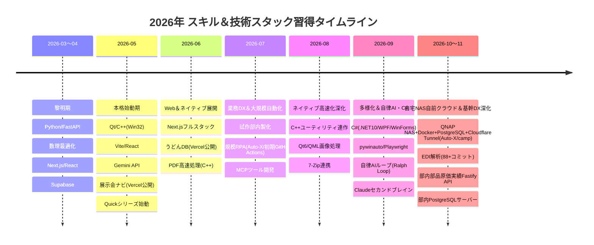

# スキル・習得技術スタック 月別履歴＆層別マトリクス レポート

本レポートは、`manage` ワークスペースおよび関連する全48+プロジェクト（`project`、`loop`、`obsidian-claude`、`jugo-shoten-web`等）のソースコード、設定ファイル（`docker-compose.*.yml`、`package.json`、`requirements.txt`、`Cargo.toml`、`*.csproj`、`CMakeLists.txt`、`vercel.json`、`wrangler.jsonc` 等）、Gitコミット履歴、ファイルタイムスタンプを詳細にスキャン・解析し、**2026年3月〜11月（本格開始の5月以降を中心とする約8ヶ月間）のスキル習得・開発履歴** を層別（インフラ・コンテナ、言語、フロントエンド、バックエンド、データベース、AI/RPA/低レイヤ）に体系化したものです。

---

## 1. エグゼクティブ・サマリー（半年間の進化総括）

> [!NOTE]
> **驚異的な成長スピードと技術的守備範囲**
> - **インフラ・自前クラウド・公開運用**: クラウドSaaS任せにせず、自宅QNAP NAS上で Docker + PostgreSQL 16 + Cloudflare Named Tunnel + Cloudflare Access（ゼロトラスト）による24時間常時稼働基盤を自前構築。さらに Vercel / Supabase / Cloudflare Workers/Pages を駆使し、業務外でも実用サービス（展示会ナビPWA、うどんDB）を一般公開。
> - **フロントエンド**: Next.js/ReactのモダンWebから、PWA（Service Worker/オフライン）、Streamlit、Qt 6 (QML)、C# (WPF/WinForms)、pywebview まで、Web・デスクトップ双方のGUIを網羅。
> - **低レイヤ・ネイティブ**: C++ による Win32 API 制御、NTFS MFT/ファイル走査の超高速化、PDFレンダリング移植、Rust によるバックエンド最適化。
> - **データ＆業務基盤**: Excel/VBAレガシー資産の脱却、PostgreSQL（クラウドSupabase、部内オンプレ、自宅NASコンテナ）、EDI固定長電文パーサー、Active Directory連携。
> - **AI & RPA**: 単なるプロンプト利用にとどまらず、Gemini/OpenAI API連携、MCP (Model Context Protocol) ツール開発、自律型AIエージェントのループ駆動・自己修復テスト環境、Obsidian+Claudeによる業務セカンドブレイン、pywinauto/Playwrightによるハイブリッド自動化まで到達。

---

## 2. 技術スタック層別マトリクス (Layered Tech Stack)

| レイヤ | 技術スタック・要素技術 | 該当プロジェクト / 主な用途 |
| :--- | :--- | :--- |
| **インフラ＆クラウド運用** | **QNAP NAS (Container Station) / Docker** | [Auto-X](file:///c:/Users/0120025-Z100/source/project/Auto-X), [camp](file:///c:/Users/0120025-Z100/source/project/camp)（PostgreSQL 16、Worker、Next.js standalone、自動バックアップコンテナ群の24時間常時稼働） |
| | **Cloudflare Tunnel / Cloudflare Access** | [Auto-X](file:///c:/Users/0120025-Z100/source/project/Auto-X), [camp](file:///c:/Users/0120025-Z100/source/project/camp)（ポート開放不要のセキュアトンネル、個人メール認証ゼロトラストアクセス） |
| | **Vercel デプロイ・公開** | [FieldStyle2026](file:///c:/Users/0120025-Z100/source/project/FieldStyle2026)（展示会ナビPWA本番公開）, [udon-db](file:///c:/Users/0120025-Z100/source/project/udon-db)（香川うどんツアーDB本番公開） |
| | **Cloudflare Workers / Pages** | [jugo-shoten-web](file:///c:/Users/0120025-Z100/jugo-shoten-web)（WranglerによるエッジサーバーレスWeb配信） |
| | **GitHub Actions** | [Auto-X](file:///c:/Users/0120025-Z100/source/project/Auto-X)（最初期のCI/CDクラウド自動化実行から自宅NAS自前インフラへの進化） |
| **主要言語** | **Python** | [myerp](file:///c:/Users/0120025-Z100/source/project/myerp), [Auto-X](file:///c:/Users/0120025-Z100/source/project/Auto-X), [shisaku-system](file:///c:/Users/0120025-Z100/source/project/shisaku-system), [jinji-db](file:///c:/Users/0120025-Z100/source/project/jinji-db), [camp](file:///c:/Users/0120025-Z100/source/project/camp), [udon-db](file:///c:/Users/0120025-Z100/source/project/udon-db)（バックエンド・自動化・データエンジニアリングの基幹） |
| | **C++** | [QuickImageView](file:///c:/Users/0120025-Z100/source/project/QuickImageView) (Qt 6), [QuickMarkPDF](file:///c:/Users/0120025-Z100/source/project/QuickMarkPDF), [QuickFolderSize](file:///c:/Users/0120025-Z100/source/project/QuickFolderSize), [QuickFileCopy](file:///c:/Users/0120025-Z100/source/project/QuickFileCopy), [QuickDiskRescue](file:///c:/Users/0120025-Z100/source/project/QuickDiskRescue)（高速I/O、Win32、メモリ・ポインタ制御） |
| | **C# (.NET 10)** | [QuickDock](file:///c:/Users/0120025-Z100/source/project/QuickDock)（Windowsデスクトップ常駐型ドッキングランチャー、WinForms / WPF） |
| | **TypeScript / JavaScript** | [FieldStyle2026](file:///c:/Users/0120025-Z100/source/project/FieldStyle2026), [myDB](file:///c:/Users/0120025-Z100/source/project/myDB), [suuri-chat](file:///c:/Users/0120025-Z100/source/project/suuri-chat), [SNS Management](file:///c:/Users/0120025-Z100/source/project/SNS%20Management), [jugo-shoten-web](file:///c:/Users/0120025-Z100/jugo-shoten-web), [game-tank](file:///c:/Users/0120025-Z100/source/project/game-tank) |
| | **Rust** | [myerp/erp-backend-rs](file:///c:/Users/0120025-Z100/source/project/myerp/erp-backend-rs)（数理最適化・計算集中型バックエンド） |
| | **Gleam** | [gleam](file:///c:/Users/0120025-Z100/source/project/gleam)（BEAM/Erlang仮想マシン上で動作する新世代型安全言語の検証） |
| | **PowerShell / Bash** | [bunai-server](file:///c:/Users/0120025-Z100/source/project/bunai-server), [Auto-X](file:///c:/Users/0120025-Z100/source/project/Auto-X) (NAS entrypoint), [project-LLM](file:///c:/Users/0120025-Z100/source/project/project-LLM) |
| | **SQL** | PostgreSQL / SQLite 向け DDL, DML, パフォーマンスクエリ, バックアップ自動化 |
| **フロントエンド** | **React / Next.js (App Router)** | [camp](file:///c:/Users/0120025-Z100/source/project/camp) (Next.js standalone), [myDB](file:///c:/Users/0120025-Z100/source/project/myDB), [suuri-chat](file:///c:/Users/0120025-Z100/source/project/suuri-chat), [SNS Management](file:///c:/Users/0120025-Z100/source/project/SNS%20Management), [jugo-shoten-web](file:///c:/Users/0120025-Z100/jugo-shoten-web) |
| | **Vite + React + PWA** | [FieldStyle2026](file:///c:/Users/0120025-Z100/source/project/FieldStyle2026)（PWA・最短ルートナビ・オフラインキャッシュ）, [jinji-db](file:///c:/Users/0120025-Z100/source/project/jinji-db) |
| | **Qt 6 / QML** | [QuickImageView](file:///c:/Users/0120025-Z100/source/project/QuickImageView), [QuickFolderSize](file:///c:/Users/0120025-Z100/source/project/QuickFolderSize)（モダンデスクトップGUI、ハードウェアアクセラレーション） |
| | **WPF / WinForms** | [QuickDock](file:///c:/Users/0120025-Z100/source/project/QuickDock)（Windowsネイティブ枠なし半透明ドックUI、ドラッグ＆ドロップ） |
| | **pywebview / WebUI** | [auto-window](file:///c:/Users/0120025-Z100/source/project/auto-window), [QuickDiskBench](file:///c:/Users/0120025-Z100/source/project/QuickDiskBench)（HTML/CSS/JSを用いた軽量デスクトップUI） |
| | **Streamlit** | [udon-db](file:///c:/Users/0120025-Z100/source/project/udon-db)（データ探索・管理ダッシュボード） |
| **バックエンド** | **FastAPI** | [myerp](file:///c:/Users/0120025-Z100/source/project/myerp), [shisaku-system](file:///c:/Users/0120025-Z100/source/project/shisaku-system), [ap-drill](file:///c:/Users/0120025-Z100/source/project/ap-drill), [shadowing-lab](file:///c:/Users/0120025-Z100/source/project/shadowing-lab), [chumonsho-2seikan](file:///c:/Users/0120025-Z100/source/project/chumonsho-2seikan), [jinji-db](file:///c:/Users/0120025-Z100/source/project/jinji-db) |
| | **Fastify (Node.js / TypeScript)** | [buhin-jisseki](file:///c:/Users/0120025-Z100/source/project/buhin-jisseki)（購入部品原価実績DB 読取専用セキュアREST APIサーバー） |
| | **Rust Backend** | [myerp/erp-backend-rs](file:///c:/Users/0120025-Z100/source/project/myerp/erp-backend-rs) (Cargoベース) |
| | **Express (Node.js)** | [QuickDiskBench](file:///c:/Users/0120025-Z100/source/project/QuickDiskBench), [seikan_2](file:///c:/Users/0120025-Z100/source/project/seikan_2) 等のローカルAPIサーバー |
| **データベース** | **PostgreSQL (QNAP NAS Docker)** | [Auto-X](file:///c:/Users/0120025-Z100/source/project/Auto-X) (`autox_db`), [camp](file:///c:/Users/0120025-Z100/source/project/camp) (`camp_db` + 14世代ローテーションバックアップ) |
| | **PostgreSQL (社内オンプレ)** | [bunai-server](file:///c:/Users/0120025-Z100/source/project/bunai-server) (部内専用サーバー自動構築・運用), [jinji-db](file:///c:/Users/0120025-Z100/source/project/jinji-db), [chumonsho-2seikan](file:///c:/Users/0120025-Z100/source/project/chumonsho-2seikan), [shisaku-system](file:///c:/Users/0120025-Z100/source/project/shisaku-system) |
| | **Supabase (PostgreSQL BaaS)** | [udon-db](file:///c:/Users/0120025-Z100/source/project/udon-db) (東京リージョン), [myDB](file:///c:/Users/0120025-Z100/source/project/myDB), [ap-drill](file:///c:/Users/0120025-Z100/source/project/ap-drill), [shadowing-lab](file:///c:/Users/0120025-Z100/source/project/shadowing-lab)（Auth/RLS/クラウド連携） |
| | **Active Directory / LDAP** | [jinji-db](file:///c:/Users/0120025-Z100/source/project/jinji-db)（組織・人事・社員情報の自動取得・同期） |
| | **Notion API / 突合** | [camp](file:///c:/Users/0120025-Z100/source/project/camp)（119シート・14MB Excelからのデータ移行、文字化けゼロDiff検証） |
| | **SQLite / キャッシュ** | [myerp](file:///c:/Users/0120025-Z100/source/project/myerp), [shadowing-lab](file:///c:/Users/0120025-Z100/source/project/shadowing-lab), 各種デスクトップツールローカルキャッシュ |
| **AI / RPA / 先端連携** | **自律AIループ / Agent Loop** | [agent-loop-demo](file:///c:/Users/0120025-Z100/source/loop/agent-loop-demo)（テスト失敗検知→コード自己修復→TDD自動ループ検証） |
| | **Claude × Obsidian セカンドブレイン** | [obsidian-claude](file:///c:/Users/0120025-Z100/source/obsidian-claude)（製造業務ヒアリング、SaaS選定基準、ナレッジ体系化） |
| | **LLM API & Agent** | Gemini API, OpenAI API, Claude API, Ollama, [suuri-chat](file:///c:/Users/0120025-Z100/source/project/suuri-chat), [shadowing-lab](file:///c:/Users/0120025-Z100/source/project/shadowing-lab) |
| | **MCP (Model Context Protocol)** | [fabric](file:///c:/Users/0120025-Z100/source/project/fabric) (Microsoft Fabric / OneLake Lakehouse連携MCPサーバー), [note](file:///c:/Users/0120025-Z100/source/project/note) |
| | **デスクトップ / Web RPA** | [auto-window](file:///c:/Users/0120025-Z100/source/project/auto-window) (pywinauto + Playwright), [Auto-X](file:///c:/Users/0120025-Z100/source/project/Auto-X) (170コミットの大規模自動化) |
| | **Windows Native / 低レイヤ** | Win32 API, NTFS走査, 非マウントドライブ直接アクセス ([QuickDiskRescue](file:///c:/Users/0120025-Z100/source/project/QuickDiskRescue)), 7-Zip DLL/CLI連携 ([Quick7Zip](file:///c:/Users/0120025-Z100/source/project/Quick7Zip)) |

---

## 3. 月別 習得技術・プロジェクト詳細履歴 (Monthly Timeline)

### 【2026年3月〜4月】黎明期：Webフルスタックと数理最適化の基礎確立
- **習得・活用技術**: Python, FastAPI, SQLite, 数理最適化（MILP / 設備負荷平準化）, Next.js, React, Tailwind CSS, Supabase, Google Gemini API
- **主要プロジェクト**:
  - [myerp](file:///c:/Users/0120025-Z100/source/project/myerp): 多階層BOM管理、設備負荷平準化、AIアシスタント搭載ERP。バックエンドにRust（`erp-backend-rs`）も導入。
  - [myDB](file:///c:/Users/0120025-Z100/source/project/myDB): Supabase + Next.js + Gemini AIチャットアシスタントによる自律型データベース管理。

---

### 【2026年5月】本格始動期：C++ネイティブ開発 ＆ Webツールの一般公開展開
- **習得・活用技術**: C++, Win32 API, Vite, React, TypeScript, PWA, Vercel デプロイ, Lucide Icons, メール自動化
- **主要プロジェクト**:
  - [FieldStyle2026](file:///c:/Users/0120025-Z100/source/project/FieldStyle2026): **Vite + React + PWA による展示会ナビアプリ。Vercel にデプロイし一般公開（[fieldstyle-nav.vercel.app](https://fieldstyle-nav.vercel.app)）**。東京ビッグサイトのブース検索・フロア跨ぎ最短ナビ・オフラインキャッシュを完全実装。
  - [QuickFolderSize](file:///c:/Users/0120025-Z100/source/project/QuickFolderSize): C++によるWindowsファイルシステム/フォルダサイズ高速算出ユーティリティ（「Quickシリーズ」の第1弾）。
  - [map_maker_cl](file:///c:/Users/0120025-Z100/source/project/map_maker_cl): Pythonによる地図・マップデータ生成。
  - [mail_manage](file:///c:/Users/0120025-Z100/source/project/mail_manage): FastAPI + Win32/Outlook連携によるメール管理・自動化。
  - [game-tank](file:///c:/Users/0120025-Z100/source/project/game-tank): Vite + HTML5 Canvas/JavaScript による軽量ブラウザゲーム。

---

### 【2026年6月】Web＆ネイティブ双方の本格展開とC++高速化 ＆ 店舗DB公開
- **習得・活用技術**: C++（PythonからのC++高速化移植）, Streamlit, Next.js, Supabase, Vercel, Google Maps API, AIエージェント設計
- **主要プロジェクト**:
  - [udon-db](file:///c:/Users/0120025-Z100/source/project/udon-db) (145コミット): **Supabase (PostgreSQL 東京リージョン) + Vercel による香川うどん店舗・履歴データベース**。7テーブル構成、Google Maps座標連携、Vercel Serverlessによる一般公開運用。
  - [QuickMarkPDF](file:///c:/Users/0120025-Z100/source/project/QuickMarkPDF) (122コミット): PDF透かし・印影高速捺印ツール。PythonプロトタイプからC++へのポーティングを行い、ボトルネック解消と劇的な高速化を達成（`CPP_PORT_POSTMORTEM.md` に詳細記録）。
  - [suuri-chat](file:///c:/Users/0120025-Z100/source/project/suuri-chat): 数理的思考と詩的感性を併せ持つAI相談チャット（Next.js + Tailwind + LLM）。
  - [SNS Management](file:///c:/Users/0120025-Z100/source/project/SNS%20Management): Next.js + PostgreSQL によるSNS運用管理システム。
  - [note](file:///c:/Users/0120025-Z100/source/project/note): note執筆・自動投稿ワークフロー。

---

### 【2026年7月】基幹業務DX化 ＆ 大規模RPA・初期クラウド自動化・MCP
- **習得・活用技術**: Playwright, GitHub Actions (CI/CD自動実行), Microsoft Fabric / OneLake Lakehouse, MCP (Model Context Protocol), 大規模業務自動化
- **主要プロジェクト**:
  - [Auto-X](file:///c:/Users/0120025-Z100/source/project/Auto-X) (170コミット): 業務プロセスのフルオートメーションを実現する大規模自動化基盤。**初期は GitHub Actions によるクラウド自動実行を採用**し、のちに自宅NASのDocker環境へ自律発展。
  - [shisaku-system](file:///c:/Users/0120025-Z100/source/project/shisaku-system): 従来の「Excel＋VBAマクロ」による原価見積業務を、FastAPI + PostgreSQL + Web内製システムへ移行するDX基盤。
  - [fabric](file:///c:/Users/0120025-Z100/source/project/fabric): Microsoft Fabric / OneLake LakehouseをAIエージェントから操作するためのMCPツール開発。
  - [seikan_2](file:///c:/Users/0120025-Z100/source/project/seikan_2): 製缶・受発注業務DXシステム。

---

### 【2026年8月】「Quick」シリーズ（C++ / Qt 6 / 高速ネイティブGUI）の爆発期 ＆ データクレンジング
- **習得・活用技術**: Qt 6, QML, CMake, C++, 7-Zip内部連携, Win32 I/O, Notion API, 文字コード突合
- **主要プロジェクト**:
  - [QuickImageView](file:///c:/Users/0120025-Z100/source/project/QuickImageView): Qt 6 + QML + CMake + C++ による超軽量・高速画像ビューア＆編集ソフト。
  - [QuickFileCopy](file:///c:/Users/0120025-Z100/source/project/QuickFileCopy): Windows 10/11ネイティブ高速ファイルコピーツール（Win32バッファリング制御）。
  - [QuickDiskBench](file:///c:/Users/0120025-Z100/source/project/QuickDiskBench): ディスク速度ベンチマークツール（CrystalDiskMark風）。
  - [Quick7Zip](file:///c:/Users/0120025-Z100/source/project/Quick7Zip): 7-Zipエンジンを活用したモダンフロントエンド。
  - [camp](file:///c:/Users/0120025-Z100/source/project/camp) (第1期): 119シート・14MBの膨大なキャンプExcelデータをNotionへ移行。Unicodeエスケープによる文字化けを解明・生文字変換で文字化けゼロの精密突合を完遂。

---

### 【2026年9月】自律型AIループ・Claude連携・C#デスクトップ・Windows RPA
- **習得・活用技術**: 自律AIエージェント設計 (Ralph Loop / Agent Loop), Claude連携・ナレッジ体系化 (Obsidian), C# (.NET 10 / WPF / WinForms), pywebview, pywinauto, 音声・言語学習, Gleam言語, ローカルLLM環境ハック (Ollama/ComfyUI/Continue)
- **主要プロジェクト**:
  - [agent-loop-demo](file:///c:/Users/0120025-Z100/source/loop/agent-loop-demo): **自律型AIエージェントの自律ループ検証**。テストコードのFAILをAIが自己検知し、コード修正・再テスト合格まで自律実行するRalph Loop基盤を構築。
  - [obsidian-claude](file:///c:/Users/0120025-Z100/source/obsidian-claude): **Claudeと連携したナレッジベース・セカンドブレイン構築**。現場ヒアリング、製造ライン（ステータ部品・溶接工程）、原価見積ロジック、SaaSベンダー選定基準（データ主権・ポータビリティ）を詳細に体系化。
  - [QuickDock](file:///c:/Users/0120025-Z100/source/project/QuickDock): **C# (.NET 10 / WinForms / WPF)** によるWindows枠なしフローティングドックランチャー。
  - [auto-window](file:///c:/Users/0120025-Z100/source/project/auto-window): pywinauto（Win32/UIAアプリ操作）＋ Playwright（Web自動化）＋ pywebview（デスクトップUI）による完全脱商用RPAの内製基盤。
  - [shadowing-lab](file:///c:/Users/0120025-Z100/source/project/shadowing-lab): 英語音声のリンキング・弱形学習Webアプリ（FastAPI + Supabase + LLM）。
  - [ap-drill](file:///c:/Users/0120025-Z100/source/project/ap-drill): 応用情報技術者（AP）試験対策ドリルシステム。
  - [mont-simu](file:///c:/Users/0120025-Z100/source/project/mont-simu) (205コミット): モンテカルロシミュレーション / 数理解析GUI。
  - [QuickDiskRescue](file:///c:/Users/0120025-Z100/source/project/QuickDiskRescue): Windowsがマウントできない破損ドライブからデータを直接抽出するC++レスキューツール。
  - [gleam](file:///c:/Users/0120025-Z100/source/project/gleam): 型安全な関数型言語Gleamの環境構築と検証。
  - [project-LLM](file:///c:/Users/0120025-Z100/source/project/project-LLM) / [LLM-manage](file:///c:/Users/0120025-Z100/source/project/LLM-manage): ローカルLLM（Ollama, ComfyUI, Continue VSCode拡張のCSS修正パッチ）環境の最適化・調査。

---

### 【2026年10月（現在）】自宅NAS自前クラウド・ゼロトラスト運用 ＆ EDI・社内PostgreSQL基盤
- **習得・活用技術**: QNAP NAS (Container Station), Docker Compose, PostgreSQL 16 コンテナ運用, Cloudflare Named Tunnel, Cloudflare Access (ゼロトラスト個人認証), 14世代ローテーションバックアップ, 得意先ユニーク調達EDI電文パース, オンプレPostgreSQLサーバー構築・運用（PowerShell）, Active Directory (AD) 連携, Cloudflare Workers/Pages (Wrangler)
- **主要プロジェクト**:
  - [Auto-X](file:///c:/Users/0120025-Z100/source/project/Auto-X): **初期のGitHub Actionsから、自宅QNAP NAS上の Docker + PostgreSQL 16 + 自動アーカイブWorker + Web UI + Cloudflare Tunnel 構成へ完全移行**。24時間常時稼働かつ外部から安全にアクセスできるプライベート自動化インフラを確立。
  - [camp](file:///c:/Users/0120025-Z100/source/project/camp): **自宅QNAP NAS上に Docker Compose で PostgreSQL 16 + Next.js standalone + Cloudflare Tunnel + Cloudflare Access（ゼロトラスト個人認証）+ 14世代自動バックアップを構築**。LAN内にもポートを開けず、完全セキュアな自前SaaS環境を運用。
  - [chumonsho-2seikan](file:///c:/Users/0120025-Z100/source/project/chumonsho-2seikan): 得意先ユニーク次世代調達EDI形式の固定長Shift_JIS電文を自動解析し、PostgreSQLへ正規化格納するミッションクリティカルなバッチ/Webシステム。
  - [bunai-server](file:///c:/Users/0120025-Z100/source/project/bunai-server): 部内専用PostgreSQLデータベースサーバーの自動構築スクリプト（PowerShell）、ロール/権限管理、Power Automate連携、IT部門向け申請手順の確立。
  - [jinji-db](file:///c:/Users/0120025-Z100/source/project/jinji-db): 従来のExcel VBA人事リストから脱却し、Active Directory (AD) から自動収集してPostgreSQLに集約、React/FastAPIで閲覧・管理する人事DB。
  - [jugo-shoten-web](file:///c:/Users/0120025-Z100/jugo-shoten-web): Cloudflare Workers / Pages (Wrangler) + Next.js によるエッジ配信基盤。
  - [supplier-manage](file:///c:/Users/0120025-Z100/source/project/supplier-manage): サプライヤー・調達データ管理。
  - [ikusei-taikei-2026](file:///c:/Users/0120025-Z100/source/project/ikusei-taikei-2026): 人材育成体系・職能資格基準（STAR法）の整理。

---

## 4. 総評・スキルの強み

1. **「自前プライベートクラウドからパブリッククラウド公開まで」完結できるインフラ・運用力**
   - クラウドSaaSやベンダーに依存せず、自宅QNAP NAS上でDocker+PostgreSQL+Cloudflare Tunnelによる24時間常時稼働基盤をゼロから立ち上げ、Cloudflare Accessによるゼロトラスト認証まで実装。さらにVercelやSupabaseを用いて業務外の実用サービス（展示会ナビPWA、うどんDB）を即座に一般公開・運用できる高度な自律インフラ構築力を証明しています。
2. **「業務課題の発見」から「低レイヤ/ネイティブでの根本解決」まで一気通貫で完結できる実行力**
   - 現場のExcelマクロやEDI固定長電文の課題を、単なるWeb化にとどまらず、Active Directory連携やオンプレPostgreSQLサーバー構築まで自らやり切る実務推進力があります。
3. **高速化・パフォーマンスへの強いこだわり**
   - Pythonでプロトタイプを作った後、パフォーマンスが求められる領域（PDF透かし、ファイルコピー、ディスク救出、画像閲覧）では迷わず **C++ (Qt 6, Win32 API)** や **Rust** を投入し、ベンチマークと高速化を徹底しています。
4. **最新技術（AI / MCP / 自律AIループ / .NET 10 / Gleam）へのキャッチアップと即時実践力**
   - Anthropic提唱のMCP (Model Context Protocol) をいち早く導入してFabric Lakehouseと接続したり、テスト駆動で自律修正するAIエージェントループ（Ralph Loop）の構築、Obsidian連携による業務ナレッジベース化、.NET 10でのWPF/WinFormsアプリ開発など、技術の選定眼と適応力が極めて秀逸です。
