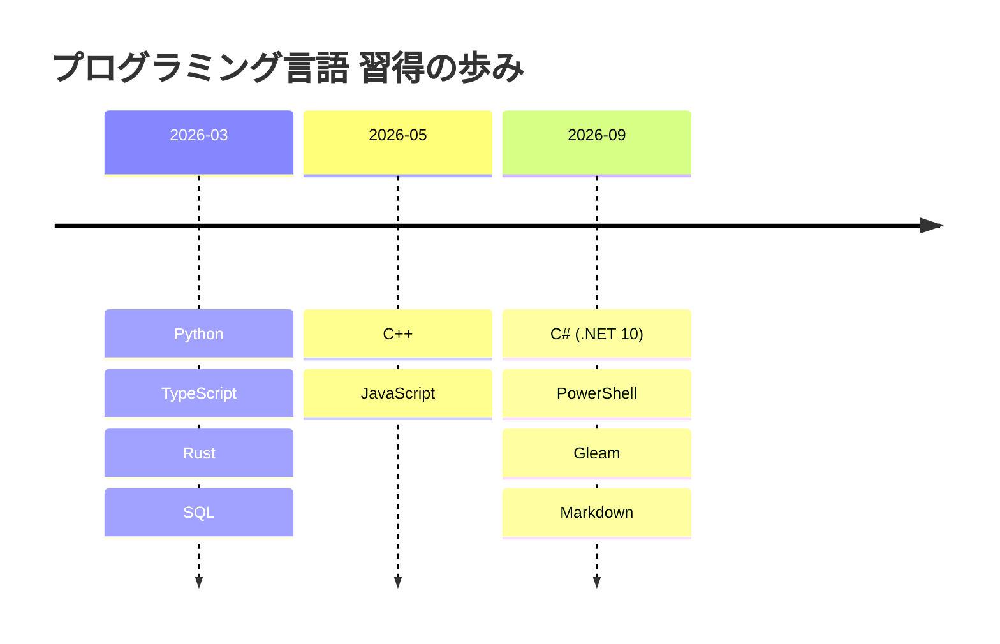
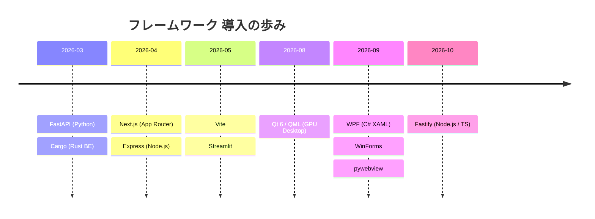
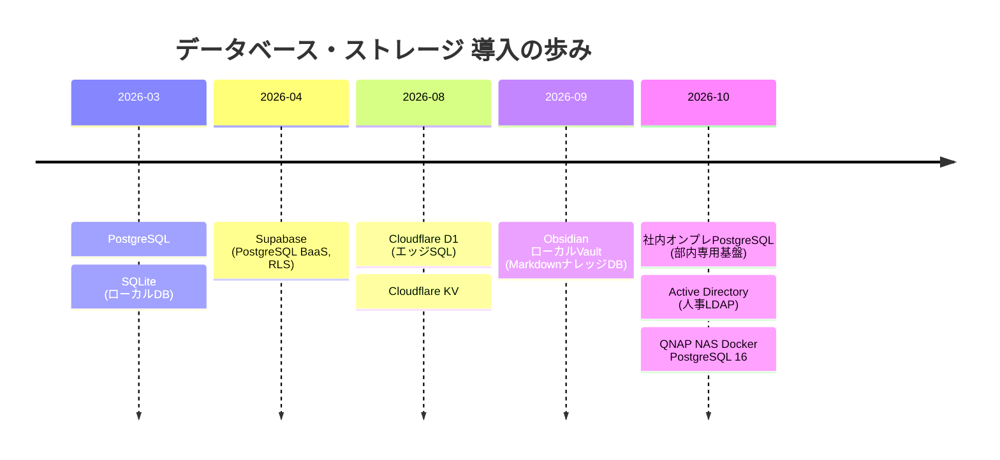
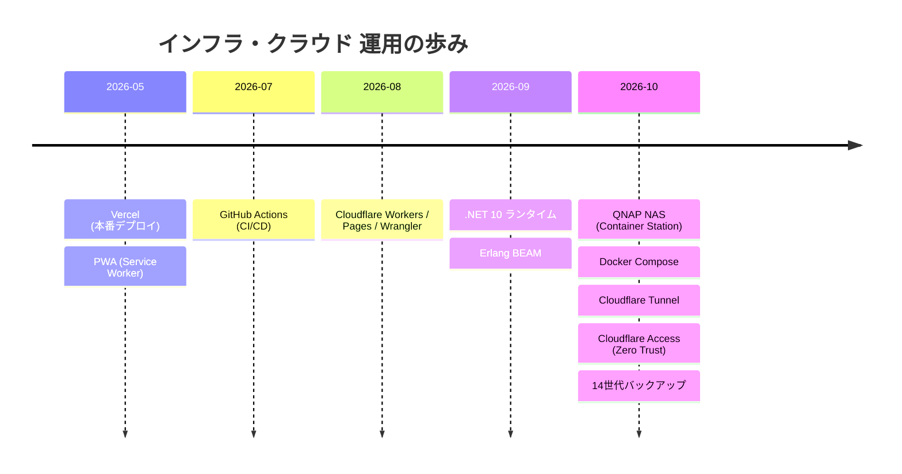
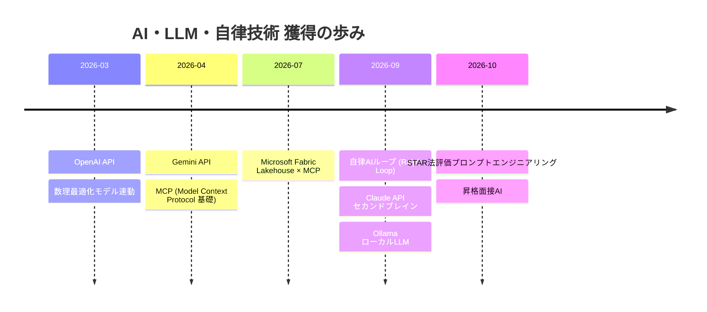

# 🛠️ 技術スタック時系列習得・導入マップ (Technology Acquisition Timeline Matrix)

> **コンセプト**: プロジェクト視点（成果物単位）ではなく、**「技術視点（どのタイミングでどの言語・FW・ライブラリ・DB・インフラ・AIを初めて習得・導入したか）」** に特化して時系列で整理した技術進化体系表です。  
> **対象期間**: 2026年3月〜11月（約8ヶ月間）  
> **カテゴリ分類**: 7大技術レイヤ（言語、Web/APIフレームワーク、デスクトップ/GUI、ライブラリ/SDK、データベース/データストア、インフラ/クラウド/プラットフォーム、AI/LLM/プロトコル）

---

## 1. 📅 技術スタック月別・層別 導入マトリクス (Monthly Acquisition Matrix)

| 着手年月 | ① 言語 (Languages) | ② Web/API フレームワーク | ③ デスクトップ & ネイティブGUI | ④ ライブラリ & ツールキット | ⑤ データベース & データストア | ⑥ プラットフォーム & クラウド・インフラ | ⑦ 先端AI・LLM & 自律プロトコル |
| :--- | :--- | :--- | :--- | :--- | :--- | :--- | :--- |
| **2026.03** （黎明期） | **Python** **Rust** **TypeScript** **SQL** | **FastAPI** Cargo (Rust Backend) | — | **React** **Pandas** PuLP / SciPy (数理最適化MILP) openpyxl / xlwings | **PostgreSQL** **SQLite** | — | **OpenAI API** 数理モデル自動解法 |
| **2026.04** （Web基盤） | — | **Next.js** (App Router) **Express** (Node.js) | — | **Tailwind CSS** | **Supabase** (PostgreSQL BaaS, RLS) | — | **Gemini API** 連動 **MCP** (Model Context Protocol 基礎) |
| **2026.05** （ネイティブ始動） | **C++** **JavaScript** | **Vite** **Streamlit** | — | **Win32 API** (Windows Native SDK) Lucide Icons | — | **Vercel** 本番デプロイ **PWA** (Service Worker, オフライン) | — |
| **2026.06** （高速化展開） | — | — | — | **CMake** (C++ビルド基盤) PDF Rendering Engine (高速マーキング) | — | Vercel Serverless Functions | Gemini ストリーミング対話 マルチモーダル対話 |
| **2026.07** （大規模DX） | — | — | — | **Playwright** (ブラウザ高速自動化) | — | **GitHub Actions** (CI/CD クラウド自動実行) | **Microsoft Fabric Lakehouse** × MCP |
| **2026.08** （GPU・低レイヤ） | — | — | **Qt 6 / QML** (GPUハードウェアアクセラレーション) | **7-Zip DLL / CLI SDK** Win32 I/Oバッファ制御 | **Cloudflare D1** (Serverless SQL) Cloudflare KV (Key-Value) | **Cloudflare Workers** (エッジサーバーレス) **Cloudflare Pages** Wrangler CLI | Notion API 完全突合バッチ |
| **2026.09** （先端自律AI・C#） | **C#** (.NET 10) **PowerShell** **Gleam** (BEAM言語) Markdown | — | **WPF** (XAML) **Windows Forms** (WinForms) **pywebview** (HTML5デスクトップ) | **pywinauto** (Windows UI Automation) **Jest** (TDDテストランナー) | ローカルVault (Obsidian Markdown DB) | **.NET 10 Runtime** BEAM (Erlang 仮想マシン) | **自律型AIループ** (Ralph Loop / TDD自己修復) **Claude API** (セカンドブレイン連動) **Ollama** (ローカルLLMハック) |
| **2026.10〜11** （自宅NAS自前クラウド・基幹DX深化） | — | **Fastify** (TypeScript高速REST API) | — | **node-postgres** (pg) LDAP / AD連携ライブラリ | **社内オンプレPostgreSQL** (部内専用サーバー) **Active Directory** (組織・人事マスタディレクトリ) | **QNAP NAS** (Container Station) **Docker / Docker Compose** **Cloudflare Tunnel** (Named Tunnel) **Cloudflare Access** (Zero Trust認証) pg_dump 14世代ローテーション自動バックアップ | **STAR法 評価プロンプト設計** 昇格模擬面接AIエンジン |

---

## 2. 🧬 技術スタック別：累積獲得ロードマップ (Cumulative Tech Stack)

### ① 言語 (Programming Languages)

- **スクリプト・AI・データ**: Python（FastAPI, Pandas, PuLP, 自動化）
- **モダンWebフルスタック**: TypeScript, JavaScript（React, Next.js, Fastify）
- **超高速・低レイヤ・システムプログラミング**: C++（Win32, Qt6, CMake）, Rust（計算集中エンジン）
- **Windowsネイティブ常駐**: C#（.NET 10, WPF, WinForms）
- **インフラ・運用自動化**: PowerShell, SQL（PostgreSQL, SQLite）
- **関数型・次世代検証**: Gleam（Erlang BEAM仮想マシン）

---

### ② Web / バックエンド & デスクトップGUI フレームワーク

- **Web/API**: FastAPI（型安全Python API）、Next.js（App Router SSR/SSG）、Fastify（高速Node/TS）、Express、Streamlit、Vite
- **デスクトップGUI**: Qt 6 / QML（GPUアクセラレーション）、WPF / WinForms（.NET 10ネイティブ）、pywebview（Web技術流用デスクトップ）

---

### ③ データベース & ストレージ技術

- **リレーショナルDB**: PostgreSQL（Dockerコンテナ、社内オンプレ、クラウドSupabaseの3形態を完備）、SQLite
- **BaaS / エッジ**: Supabase（Row Level Security / 認証連携）、Cloudflare D1 / KV
- **エンタープライズディレクトリ**: Active Directory（LDAP人事マスタ自動同期）

---

### ④ クラウド・インフラ & 自宅NAS運用基盤

- **自前クラウド（自宅NAS）**: QNAP NAS上で Docker Compose を駆使し、PostgreSQL 16、Next.js standalone、常駐バッチを24時間運用。
- **ゼロトラスト公開**: ポート開放不要の Cloudflare Named Tunnel ＋ メールワンタイムPIN認証の Cloudflare Access。
- **パブリッククラウド・エッジ**: Vercel（PWA本番運用）、Cloudflare Workers / Pages（エッジ配信）、GitHub Actions（CI/CD自動化）。

---

### ⑤ 先端AI・自律エージェント & プロトコル

- **API連携**: OpenAI API, Gemini API（ストリーミング対話）, Claude API
- **プロトコル・先端ハック**: MCP（Model Context Protocol 自作連携ツール）, Ollama（ローカルLLM/プロンプトハック）
- **自律化**: Ralph Loop（Jestテスト失敗を検知してAIがコードを自己修復する自律AIループ）
- **業務評価AI**: STAR法に基づくキャリア・昇格面接AI評価ロジック

---

## 3. 🎯 技術視点で振り返る「5大ブレイクスルー」

1. **Web × 低レイヤの二刀流確立（5月〜6月）**:
   Next.js/ReactのWebモダンスタックを使いこなす一方で、C++によるWin32 API直接叩き・NTFS高速走査・Python処理のC++高速移植を達成。「Webしか作れない」「低レイヤしか触れない」の壁を完全に突破。
2. **脱商用RPA・ハイパー自動化の完成（7月〜9月）**:
   年間ライセンス費数百万円のUiPathやPower Automate Desktop等の商用RPAに頼らず、Playwright（Web）× pywinauto（WindowsデスクトップUIA）× 自作CLIで完全内製化。
3. **自前ゼロトラスト・クラウドの構築（10月）**:
   外部の有料SaaSに依存せず、自宅QNAP NAS上に Docker + PostgreSQL 16 + Cloudflare Tunnel/Access を自力構築し、24時間常時稼働かつ安全な外部アクセス環境を確立。
4. **自律AIループ＆セカンドブレインの実証（9月）**:
   単なるチャットボット利用を超え、Jestのテスト失敗をAIが自動修復する自律ループ（Ralph Loop）や、Obsidian+Claudeによる業務知識体系化を実現。
5. **Fastify / TypeScript によるエンタープライズセキュアAPI（10月〜11月）**:
   基幹サーバー上の機密実績データを、最小権限・ループバック限定・接続プール制御を徹底したFastify REST APIとして安全に外出しするアーキテクチャを確立。

